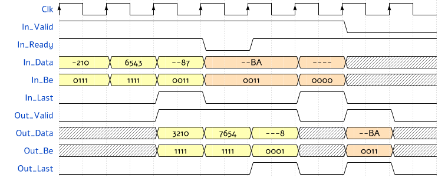

# olo_base_stream_join

[Back to **Entity List**](../EntityList.md)

## Status Information

VHDL Source: [olo_base_stream_join](../../src/base/vhdl/olo_base_stream_join.vhd)

## Description

This entity packs the valid bytes of an AXI4-Stream. An input beat may carry fewer bytes than the bus width; the
output carries the bytes of each packet in their order without gaps. Every output beat is full except the last beat of
a packet.

Usage examples:

- Joining the buffers of a DMA packet: each buffer is read starting in lane 0 with a partial last beat, the entity
  closes the gaps between the buffers.
- Removing the empty lanes of a stream whose beats are only partly filled.

[olo_base_stream_split](./olo_base_stream_split.md) is the counterpart that cuts packets into segments.

### Byte Enables

_In_Be_ marks the valid bytes of every input beat. They must be contiguous from lane 0 (bit 0 first, no gaps), and
any number from 0 to _Width_g_/8 is allowed. Unlike the **Trailing-Only Byte-Enable** convention (see
[Conventions](../Conventions.md)), any beat may be partial or empty. An empty beat with _In_Last_ only ends the packet
(closing beat).

The output follows the **Trailing-Only Byte-Enable** convention with one exception: a packet without any byte (only
empty beats) gives one beat with _Out_Be_ all '0' and _Out_Last_ = '1', so that every input packet results in one
output packet. Data lanes with _Out_Be_ = '0' are zero.

### Timing

The entity takes one input beat per clock cycle. When the last beat of a packet leaves more bytes than fit into one
output beat, the entity outputs two beats and inserts one clock cycle with _In_Ready_ = '0'. So at most one cycle is
inserted per packet.

An output beat is sent only when more than one beat of bytes is available or the packet ends. Up to _Width_g_/8 bytes
are held until the next input beat shows whether the packet continues. This keeps the last output beat of a packet
non-empty even if the packet ends with an empty closing beat. On an aligned stream (full input beats), an output beat
therefore follows one input beat later.

The outputs are registered. _In_Ready_ depends on _Out_Ready_ within the clock cycle. _Rst_ clears the held bytes at
any time.

The example below (_Width_g_ = 32) shows a packet of 9 bytes in beats of 3, 4 and 2 bytes, then a packet of 2 bytes
closed by an empty beat. Digits and letters stand for the bytes (lane 3 left), '-' for lanes without a valid byte.

## Generics

| Name    | Type     | Default | Description                                      |
| :------ | :------- | ------- | :----------------------------------------------- |
| Width_g | positive | -       | Data width in bits, a multiple of 8 (8 to 1024)  |

## Interfaces

### Control

| Name | In/Out | Length | Default | Description                                     |
| :--- | :----- | :----- | ------- | :---------------------------------------------- |
| Clk  | in     | 1      | -       | Clock                                           |
| Rst  | in     | 1      | -       | Reset input (high-active, synchronous to _Clk_) |

### Input Data

| Name     | In/Out | Length      | Default | Description                                                             |
| :------- | :----- | :---------- | ------- | :---------------------------------------------------------------------- |
| In_Data  | in     | _Width_g_   | -       | Input data                                                              |
| In_Be    | in     | _Width_g_/8 | all '1' | Valid bytes of the beat, contiguous from lane 0 (all '0' allowed)       |
| In_Valid | in     | 1           | '1'     | AXI4-Stream handshaking signal for _In_Data_                            |
| In_Ready | out    | 1           | N/A     | AXI4-Stream handshaking signal for _In_Data_                            |
| In_Last  | in     | 1           | '0'     | AXI4-Stream end of packet signaling for _In_Data_                       |

### Output Data

| Name      | In/Out | Length      | Default | Description                                                            |
| :-------- | :----- | :---------- | ------- | :--------------------------------------------------------------------- |
| Out_Data  | out    | _Width_g_   | N/A     | Output data (lanes without a valid byte are zero)                      |
| Out_Be    | out    | _Width_g_/8 | N/A     | Output byte enables (Trailing-Only, all '0' only for an empty packet)  |
| Out_Valid | out    | 1           | N/A     | AXI4-Stream handshaking signal for _Out_Data_                          |
| Out_Ready | in     | 1           | '1'     | AXI4-Stream handshaking signal for _Out_Data_                          |
| Out_Last  | out    | 1           | N/A     | AXI4-Stream end of packet signaling for _Out_Data_                     |

## Architecture

The entity keeps the bytes not yet output in a carry register (up to _Width_g_/8 bytes, from lane 0). For every input
beat, the carry and the valid input bytes form a sequence of up to two beats of bytes: the input is shifted by the
number of held bytes. If the sequence holds more than one beat of bytes, its first beat is output and the rest stays in
the carry; otherwise all bytes stay in the carry. At the end of a packet all bytes are output, in one or two beats.

The shifter is a multiplexer per byte lane with up to _Width_g_/8 + 1 inputs, so the logic grows with the square of
the number of byte lanes.
