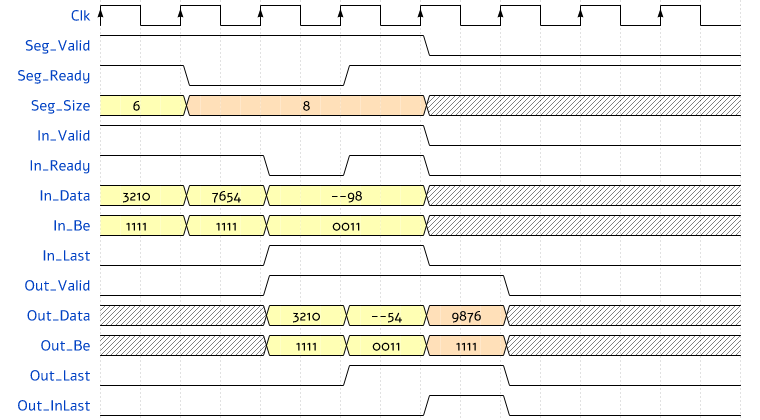

# olo_base_stream_split

[Back to **Entity List**](../EntityList.md)

## Status Information

VHDL Source: [olo_base_stream_split](../../src/base/vhdl/olo_base_stream_split.vhd)

## Description

This entity cuts the packets of an AXI4-Stream into segments. The size of every segment is given in bytes on a command
interface, so a segment may end at any byte. Every segment starts in lane 0 and ends with _Out_Last_. The segment in
which the input packet ends is marked with _Out_InLast_; it is shorter than its command size if the packet ends
before.

Usage examples:

- Writing a received packet into DMA buffers of any length: the entity cuts the packet at the end of every buffer and
  starts the next buffer in lane 0.
- Cutting packets into chunks of a number of bytes: with _Seg_Valid_ = '1' and a constant _Seg_Size_.
  [olo_base_chunker](./olo_base_chunker.md) cuts into chunks of whole beats without moving any byte.

[olo_base_stream_join](./olo_base_stream_join.md) is the counterpart that joins segments into packets.

### Segments

- A segment command (_Seg_Size_ in bytes, 1 to _MaxSegSize_g_) is accepted with _Seg_Valid_ and _Seg_Ready_ while no
  segment is active. It applies in the clock cycle it is accepted.
- The segment takes the next _Seg_Size_ bytes of the current packet, or the rest of the packet if the packet ends
  before.
- _Out_InLast_ = '1' on the last beat of the segment in which the packet ends, also if the packet ends exactly with
  the last byte of the segment. The next segment then starts with the first byte of the next packet.
- A packet without any byte (one empty beat with _In_Last_) uses one segment command and gives one beat with _Out_Be_
  all '0', _Out_Last_ = '1' and _Out_InLast_ = '1'.
- No input beat is accepted while no segment is active: a packet waits at the input until its first segment is
  commanded.

### Byte Enables

_In_Be_ marks the valid bytes of every input beat, as for [olo_base_stream_join](./olo_base_stream_join.md): they
must be contiguous from lane 0 (bit 0 first, no gaps), and any number from 0 to _Width_g_/8 is allowed. This includes
the **Trailing-Only Byte-Enable** convention (see [Conventions](../Conventions.md)); in addition, any beat may be
partial or empty. An empty beat with _In_Last_ only ends the packet (closing beat).

Every segment follows the **Trailing-Only Byte-Enable** convention: its beats are full except the last one. The only
exception is the beat of a packet without any byte (_Out_Be_ all '0'). Data lanes with _Out_Be_ = '0' are zero.

### Timing

The entity outputs one beat per clock cycle. A segment that ends inside an input beat can insert one clock cycle: the
input waits while the held bytes already fill the rest of the segment.

A beat that uses up all bytes received so far is held until the next input beat shows whether the packet continues, so
that an empty closing beat still marks it with _Out_InLast_. On an aligned stream, an output beat therefore follows one
input beat later.

The outputs and _Seg_Ready_ are registered. Because a segment command applies in the clock cycle it is accepted,
_In_Ready_ depends on _Out_Ready_, _Seg_Valid_ and _Seg_Size_ within the clock cycle. _Rst_ clears the held bytes and
the active segment at any time.

### Integration

**_Seg_Valid_ and _Seg_Size_ must not depend combinationally on _In_Ready_ or on any _Out_ signal**; otherwise a
combinational loop forms through _In_Ready_. Drive the segment commands from registers or from a FIFO, as a DMA engine
does with its descriptors.

The example below (_Width_g_ = 32) shows a packet of 10 bytes and segments of 6 and 8 bytes. The second segment ends
with the packet after 4 bytes. Digits stand for the bytes (lane 3 left), '-' for lanes without a valid byte.

## Generics

| Name         | Type     | Default | Description                                                                 |
| :----------- | :------- | ------- | :-------------------------------------------------------------------------- |
| Width_g      | positive | -       | Data width in bits, a multiple of 8 (8 to 1024)                             |
| MaxSegSize_g | positive | -       | Largest segment size in bytes (1 to 2^30 - 1); sets the width of _Seg_Size_ |

## Interfaces

### Control

| Name | In/Out | Length | Default | Description                                     |
| :--- | :----- | :----- | ------- | :---------------------------------------------- |
| Clk  | in     | 1      | -       | Clock                                           |
| Rst  | in     | 1      | -       | Reset input (high-active, synchronous to _Clk_) |

### Input Data

| Name     | In/Out | Length      | Default | Description                                                              |
| :------- | :----- | :---------- | ------- | :----------------------------------------------------------------------- |
| In_Data  | in     | _Width_g_   | -       | Input data                                                               |
| In_Be    | in     | _Width_g_/8 | all '1' | Valid bytes of the beat, contiguous from lane 0 (all '0' allowed)        |
| In_Valid | in     | 1           | '1'     | AXI4-Stream handshaking signal for _In_Data_                             |
| In_Ready | out    | 1           | N/A     | AXI4-Stream handshaking signal for _In_Data_ Depends combinationally on _Out_Ready_, _Seg_Valid_ and _Seg_Size_ |
| In_Last  | in     | 1           | '0'     | AXI4-Stream end of packet signaling for _In_Data_                        |

### Segment Commands

| Name      | In/Out | Length                         | Default | Description                                         |
| :-------- | :----- | :----------------------------- | ------- | :-------------------------------------------------- |
| Seg_Size  | in     | ceil(log2(_MaxSegSize_g_ + 1)) | -       | Size of the segment in bytes (1 to _MaxSegSize_g_) _In_Ready_ depends on it combinationally, see [Integration](#integration) |
| Seg_Valid | in     | 1                              | '1'     | AXI4-Stream handshaking signal for _Seg_Size_ _In_Ready_ depends on it combinationally, see [Integration](#integration) |
| Seg_Ready | out    | 1                              | N/A     | AXI4-Stream handshaking signal for _Seg_Size_       |

### Output Data

| Name       | In/Out | Length      | Default | Description                                                               |
| :--------- | :----- | :---------- | ------- | :------------------------------------------------------------------------ |
| Out_Data   | out    | _Width_g_   | N/A     | Output data (lanes without a valid byte are zero)                         |
| Out_Be     | out    | _Width_g_/8 | N/A     | Output byte enables (Trailing-Only per segment)                           |
| Out_Valid  | out    | 1           | N/A     | AXI4-Stream handshaking signal for _Out_Data_                             |
| Out_Ready  | in     | 1           | '1'     | AXI4-Stream handshaking signal for _Out_Data_                             |
| Out_Last   | out    | 1           | N/A     | End of a segment                                                          |
| Out_InLast | out    | 1           | N/A     | End of the input packet: last beat of the segment in which the packet ends |

## Architecture

The entity keeps the bytes not yet output in a carry register (up to _Width_g_/8 bytes, from lane 0). The carry and
the valid bytes of the input beat form a sequence of up to two beats of bytes. An output beat takes as many bytes as
the segment still needs, at most one beat; the rest is shifted down into the carry. An input beat is accepted only
while the carry holds at most the bytes of the next output beat, so the carry never overflows.

The two shifters are multiplexers per byte lane with up to _Width_g_/8 + 1 inputs, so the logic grows with the square
of the number of byte lanes.
