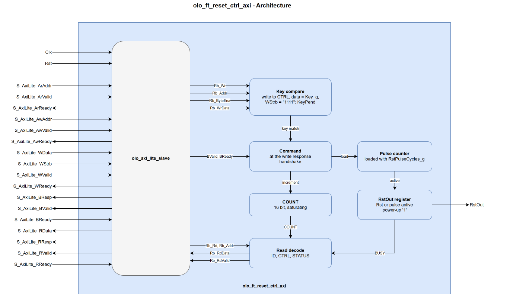

# olo_ft_reset_ctrl_axi

[Back to **Entity List**](../EntityList.md)

## Status Information


VHDL Source: [olo_ft_reset_ctrl_axi](../../src/ft/vhdl/olo_ft_reset_ctrl_axi.vhd)

## Description

This component is a **commanded reset** for a group of blocks, under software control through an
**AXI4-Lite register interface** (32-bit data width). A processor writes a 32-bit key to the CTRL
register, and the component drives a reset pulse of _RstPulseCycles_g_ clock cycles on _RstOut_. A
status register shows whether the pulse is still running and how many commands were received since
the reset of the component.

The key keeps a stray or corrupted write from resetting the blocks: only a full-word write of the
key to CTRL is a command. Typical use is the reset of a processing pipeline that software restarts
after a reconfiguration or an error, while the rest of the system keeps running.

## Generics

| Name              | Type             | Default     | Description                                                  |
| :---------------- | :--------------- | ----------- | :----------------------------------------------------------- |
| RstPulseCycles_g  | positive         | 16          | Length of the commanded reset in _Clk_ cycles (range 1 to 65535). |
| Key_g             | std_logic_vector | x"50495045" | 32-bit command value (default: ASCII "PIPE"). All zeros and all ones, the values of a stuck data bus, are rejected by an elaboration assert. |
| AxiAddrWidth_g    | positive         | 12          | AXI4-Lite address width (range 4 to 30). The address is fully decoded: a register is accessed only at its own address. |
| ReadTimeoutClks_g | positive         | 100         | Read timeout of the wrapped [olo_axi_lite_slave](../axi/olo_axi_lite_slave.md). Reads of unmapped addresses are answered through this timeout with an error response. |

## Interfaces

### Control

| Name | In/Out | Length | Default | Description                                     |
| :--- | :----- | :----- | ------- | :---------------------------------------------- |
| Clk  | in     | 1      | -       | Clock                                           |
| Rst  | in     | 1      | -       | Reset (high-active, synchronous to _Clk_). Connect a reset that is asserted at power-up, see [Power-Up and Reset](#power-up-and-reset). |

### AXI4-Lite

The full AXI4-Lite slave interface (`S_AxiLite_*`) with 32-bit data width, identical in behavior to
[olo_axi_lite_slave](../axi/olo_axi_lite_slave.md). The write byte enables matter only for CTRL: a
command needs all four.

### Reset Output

| Name   | In/Out | Length | Default | Description                                                  |
| :----- | :----- | :----- | ------- | :----------------------------------------------------------- |
| RstOut | out    | 1      | N/A     | Reset of the controlled blocks (high-active, synchronous to _Clk_), driven directly by a register. '1' while a commanded pulse runs, while _Rst_ is '1' and one cycle longer, and from power-up until the first clock edge with _Rst_ = '0'. |

## Register Map

All registers are 32-bit words; unused bits read as zero.

| Offset | Name   | Access | Content                                                      |
| :----- | :----- | :----- | :----------------------------------------------------------- |
| 0x00   | ID     | RO     | Constant x"52535401": ASCII "RST" in [31:8], version of the register map (1) in [7:0]. |
| 0x04   | CTRL   | WO     | A write of _Key_g_ with all four byte enables set is a command and starts the reset pulse. Any other write does nothing. Reads as zero. |
| 0x08   | STATUS | RO     | Bit 0: BUSY, '1' while _RstOut_ is '1'. Bits [31:16]: COUNT, number of commands since the reset of the component, saturating at 0xFFFF. |

Reads of unmapped addresses are not acknowledged and are answered by the
[olo_axi_lite_slave](../axi/olo_axi_lite_slave.md) read timeout with an error response. Writes to
read-only or unmapped addresses are ignored (the write response is OKAY).

## Detailed Description

### Architecture



The component is an [olo_axi_lite_slave](../axi/olo_axi_lite_slave.md) (AXI4-Lite protocol handling,
register-bus conversion) plus a small register process. The key compare checks every register
write; a match is held in a flag until the write response of the same transaction is handed over.
The command loads the pulse counter and increments COUNT. _RstOut_ is a register that is '1' while
_Rst_ is '1' or the pulse counter runs. The slave handles one transaction at a time, so the key and
the write response always belong to the same write.

### Command Timing

- _RstOut_ rises in the clock cycle after the write response handshake (_S_AxiLite_BValid_ and
  _S_AxiLite_BReady_ both '1') of the command and stays '1' for exactly _RstPulseCycles_g_ cycles. A
  master that holds off _S_AxiLite_BReady_ delays the reset accordingly. With _S_AxiLite_BReady_
  already '1', the write response handshake is in the cycle after the write data handshake, and
  _RstOut_ rises in the cycle after that.
- A command while _RstOut_ is '1' restarts the count: _RstOut_ stays '1' without a gap and falls
  _RstPulseCycles_g_ cycles after the write response of the last command. The slave needs at least
  four clock cycles from one write response to the next, so with _RstPulseCycles_g_ below 4 every
  command gives a pulse of its own.
- STATUS.BUSY reads _RstOut_. Software that has to wait for the end of the reset polls BUSY until it
  reads '0'.
- COUNT counts every command, also one that restarts a running pulse, and saturates at 0xFFFF. It is
  an audit of the commands software has issued: a value different from the number of key writes
  shows a lost or an unexpected command.

### Power-Up and Reset

_Rst_ resets the component itself: it ends a running pulse and clears COUNT. _RstOut_ is the
registered OR of _Rst_ and the running pulse, so it follows _Rst_ with one clock cycle of delay. A
command whose write response handshake falls on a clock edge with _Rst_ = '1' is discarded. The
component is never reset by its own _RstOut_; a command while BUSY is '1' is accepted and answered.

The _RstOut_ register has the initial value '1'. On FPGAs that load initial values with the
configuration, the controlled blocks are therefore in reset from configuration on. _Rst_ should come
from a reset generator that is asserted at power-up, for example
[olo_base_reset_gen](../base/olo_base_reset_gen.md): _RstOut_ then stays '1' until one cycle after
the release of _Rst_. With _Rst_ tied to '0', _RstOut_ falls at the first clock edge.

_RstOut_ is synchronous to _Clk_. Blocks on another clock take it through an
[olo_base_reset_gen](../base/olo_base_reset_gen.md) in their own clock domain (with _SyncTmr_g_ =
true in a radiation environment).

### Protection

The key protects against software errors and bus faults: a command needs a full-word write of
_Key_g_ to CTRL. A write of another value, a key with flipped bits, a write with a missing byte
enable, a write to another address and a stuck data bus (all zeros or all ones) do nothing.

The state of the component (the registers of the AXI4-Lite slave, the key flag, the pulse counter,
COUNT and _RstOut_) relies on the TMR of the synthesis tool, like the other _ft_ entities without a
codeword. With TMR, a single upset neither starts nor changes a reset. Without TMR, an upset of the
pulse counter or of the _RstOut_ register can start a reset or change its length.

### Usage Example

A pipeline reset commanded by software, with blocks on the system clock and on a second clock:

```vhdl
-- System reset, asserted from power-up
i_sysrst : entity olo.olo_base_reset_gen
    generic map (
        SyncTmr_g => true
    )
    port map (
        Clk    => Clk,
        RstIn  => ExtRst,
        RstOut => SysRst
    );

-- Pipeline reset, commanded through AXI4-Lite
i_pipe_rst : entity olo.olo_ft_reset_ctrl_axi
    generic map (
        RstPulseCycles_g => 16
    )
    port map (
        Clk               => Clk,
        Rst               => SysRst,
        S_AxiLite_ArAddr  => PipeRst_ArAddr,
        S_AxiLite_ArValid => PipeRst_ArValid,
        S_AxiLite_ArReady => PipeRst_ArReady,
        S_AxiLite_AwAddr  => PipeRst_AwAddr,
        S_AxiLite_AwValid => PipeRst_AwValid,
        S_AxiLite_AwReady => PipeRst_AwReady,
        S_AxiLite_WData   => PipeRst_WData,
        S_AxiLite_WStrb   => PipeRst_WStrb,
        S_AxiLite_WValid  => PipeRst_WValid,
        S_AxiLite_WReady  => PipeRst_WReady,
        S_AxiLite_BResp   => PipeRst_BResp,
        S_AxiLite_BValid  => PipeRst_BValid,
        S_AxiLite_BReady  => PipeRst_BReady,
        S_AxiLite_RData   => PipeRst_RData,
        S_AxiLite_RResp   => PipeRst_RResp,
        S_AxiLite_RValid  => PipeRst_RValid,
        S_AxiLite_RReady  => PipeRst_RReady,
        RstOut            => PipeRst
    );

-- Blocks on Clk use PipeRst directly. Blocks on OtherClk get it synchronized:
i_pipe_rst_other : entity olo.olo_base_reset_gen
    generic map (
        SyncTmr_g => true
    )
    port map (
        Clk    => OtherClk,
        RstIn  => PipeRst,
        RstOut => PipeRstOther
    );
```

A system that resets several groups independently uses one instance per group.

### Further Information

- See
  [Open Logic Fault-Tolerance Principles - Constraints That Apply Across the Area](./olo_ft_principles.md#constraints-that-apply-across-the-area)
  for the constraints that apply across the _ft_ area.
